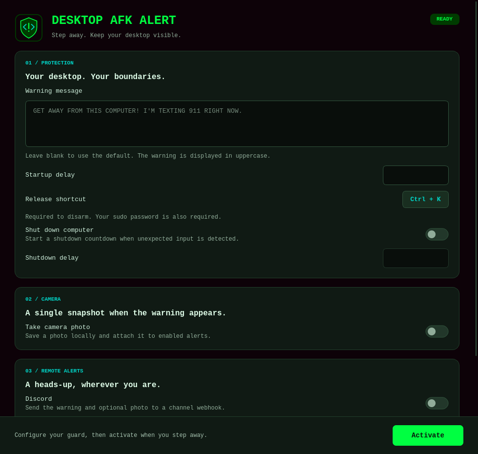

# desktop-afk-alert

Keep your desktop visible. Warn unexpected visitors.

Sometimes you want to leave your computer without locking the screen: a dashboard,
a video, or a long-running task should remain visible. Desktop AFK Alert watches
for unexpected keyboard or mouse input and puts a clear warning across every
monitor when someone interacts with your desktop.

A Python and Qt application with a Matrix-inspired interface, optional camera
snapshots, Discord and Telegram alerts, and optional automatic shutdown.



## Install

Download the x86-64 `.deb` or `.rpm` from [Releases](../../releases). Packages include
the GUI, its Python runtime, and an isolated privileged helper.

```bash
# Ubuntu 22.04+ / compatible Debian-based distributions
sudo apt install ./desktop-afk-alert_0.1.2-2_amd64.deb

# Fedora 41+
sudo dnf install ./desktop-afk-alert-0.1.2-2.x86_64.rpm
```

Use the filename of the release you downloaded. Open **Desktop AFK Alert** from
your application menu, or run `desktop-afk-alert` as your normal user.

### Arch Linux

Install the build tools on an up-to-date Arch system, then build and install from
the repository root as your normal user:

```bash
sudo pacman -Syu --needed base-devel git
git clone https://github.com/GabrielLins64/desktop-afk-alert.git
cd desktop-afk-alert
makepkg -sif
```

If you already have a checkout, run `makepkg -sif` there. It packages the current
local sources, installs missing dependencies with pacman, and asks for sudo to
install the package. Open **Desktop AFK Alert** from your application menu, or run
`desktop-afk-alert` as your normal user.

The Arch package uses system Python, Qt, and Python dependencies from the official
repositories. It includes the helper at `/usr/libexec/desktop-afk-alert-helper`;
neither uv nor `scripts/install-dev-helper.sh` is needed. Build files stay under
`build/makepkg/` unless you configured a custom `BUILDDIR` in `makepkg.conf`.

Install the desktop portal backend for your desktop (`xdg-desktop-portal-gnome`
or `xdg-desktop-portal-kde`) and a Secret Service provider such as `gnome-keyring`
or `kwallet` to remember alert credentials.

### Desktop requirements

The initial targets are GNOME and KDE, using native X11 or Wayland, on Linux with
glibc 2.35 or later. An active local desktop session, `sudo` privileges, and a
password-based account are required. A Secret Service keyring is needed to
remember alert credentials. See [validation status](docs/VALIDATION.md) for the
environments actually checked before treating a build as release-ready.

## Use

1. Set the warning message, or leave it blank for the default.
2. Keep or record a release shortcut with **1–3 simultaneous keys**. The default
   is **Ctrl+K**; left and right modifier keys are equivalent.
3. Optionally enable **Freeze cursor**, shutdown, a camera photo, Discord, or Telegram.
4. Click **Activate**, enter your sudo password, and step away during the startup
   countdown. The default delay is **5 seconds**.
5. To return, press the release shortcut and enter your sudo password again.

While armed, the desktop stays visible. An unexpected key release or mouse
button press triggers the warning. **Freeze cursor** is off by default, allowing
pointer movement while armed. Enable it to keep the pointer still. Mouse movement
and scrolling do not trigger an incident; clicks, scrolling, and keyboard events
are consumed. The pointer is always blocked in the warning and password states.
Ordinary close requests and desktop exit shortcuts are ignored during protection.

Allowing pointer movement uses `/dev/uinput` on the local `seat0`. If it is
unavailable, load the kernel module with `sudo modprobe uinput`, or enable
**Freeze cursor**. Other seats currently require **Freeze cursor**. Touchpads
are translated into virtual mouse motion, so desktop pointer acceleration may
feel different. The virtual pointer is removed when protection stops.

The warning covers every connected monitor, uses uppercase green text on black,
and includes the camera photo if enabled. Each incident takes one photo and
dispatches alerts once per enabled provider; transient delivery failures have
bounded retries. Alerts are sent only to the configured Discord and Telegram
destinations.

Shutdown is off by default. When enabled, its default delay is **60 seconds** from
the incident. Opening password entry **pauses** the remaining time, including
while you type. Cancelling or submitting an incorrect password returns to the
previous state and resumes the countdown. Correct authentication cancels it.
An operating-system shutdown request already issued at expiry cannot be recalled.
Opening password entry therefore lets anyone who knows the shortcut postpone
shutdown while that dialogue remains open.

### Camera and alerts

- **Camera:** select a device and a writable directory. Photos default to your
  system Pictures directory under `desktop-afk-alert/`. Camera access starts only
  after an incident and is limited to five seconds, including a two-second warmup
  after the first video frame so automatic exposure can settle. Capture preserves
  the device's exposure settings and releases the camera before reporting success.
  It runs in a separate user process; camera failures leave the warning screen
  active. The saved photo appears beneath the warning on every monitor. If capture
  fails, protection continues and alerts are sent without a photo.
- **Discord:** create a webhook in the destination text channel's integrations
  settings, then paste its URL. Forum/media channels require a webhook URL that
  already includes the destination `thread_id` query parameter. Mentions are
  disabled.
- **Telegram:** create a bot with [BotFather](https://t.me/BotFather), paste its
  token and destination chat ID, and start a conversation with the bot or add it
  to the destination group. The bot must be allowed to send messages and photos.

Network delivery is best effort. A short shutdown delay can end the session
before photo capture or delivery finishes.

Settings are saved on activation and normal exit to
`$XDG_CONFIG_HOME/desktop-afk-alert/settings.json`, defaulting to
`~/.config/desktop-afk-alert/settings.json`. Webhook URLs and bot tokens go into
the system keyring. If the keyring is unavailable, newly entered credentials stay
in memory for the current run. Sudo passwords are never saved. Photos and new
settings files are private to your user.

### Logs

Application and notification results are written to the console and
`~/.local/state/desktop-afk-alert/logs/desktop-afk-alert.log`. If `XDG_STATE_HOME`
is set, it replaces `~/.local/state`. Logs are private to your user and rotate at
1 MiB, keeping three backups. If the file cannot be opened, console logging
continues.

Delivery failures stay in the logs and do not appear on the frozen screen. Logs
include the provider, incident ID, HTTP status/error code, and retry attempts;
webhook URLs, bot tokens, passwords, and notification bodies are excluded.
`--diagnose` also reports the log file location.

## Run from source

Install Python 3.11+ and [uv](https://docs.astral.sh/uv/getting-started/installation/),
then run the shared native dependency installer from the checkout:

```bash
scripts/install-deps.sh
uv sync --frozen
scripts/install-dev-helper.sh
uv run desktop-afk-alert
```

The dependency installer supports Ubuntu, Debian, and Fedora. It installs the
compiler, system Python headers, native GUI libraries, and standalone-build
dependencies, including `libatomic-static` on Fedora. It requests sudo only for
package-manager commands, also runs as root in containers, and is safe to rerun
after updating the checkout. Use `scripts/install-deps.sh --dry-run` to inspect
the commands without installing anything. Install uv separately; nFPM is only
needed for packaging.
Arch Linux uses the [makepkg installation](#arch-linux) above.

The helper installer asks for sudo and copies the wheel and only its two helper
dependencies into root-owned storage under `/usr/local`. It uses `/usr/bin/python3`,
which also needs to be Python 3.11+, and checks its development headers and compiler
before requesting sudo. Installing Python through uv does not provide the system
headers needed to compile `evdev`. It does not import the
checkout as root. Re-run it after changing helper code. Distribution packages use
`/usr/libexec/desktop-afk-alert-helper` and take precedence over a development
helper. Disarm and close the application before replacing either installation.
On Ubuntu 22.04, use the distribution package: the development helper installer
requires system Python 3.11+, while Ubuntu 22.04 provides Python 3.10 by default.

To inspect your environment without activating protection:

```bash
uv run desktop-afk-alert --diagnose
```

The GUI opens without an installed helper; activation requires one.

## Build releases

Use Ubuntu 22.04 x86-64 for the glibc 2.35 baseline. Install
[uv](https://docs.astral.sh/uv/getting-started/installation/) and
[nFPM](https://nfpm.goreleaser.com/docs/install/), then prepare the native
dependencies, build, and package:

```bash
scripts/install-deps.sh
scripts/build.sh
scripts/package.sh
```

Local setup, the build container, and GitHub Actions use the same native package
lists in `scripts/install-deps.sh`. The installer includes Fedora's static
libatomic archive required by Nuitka with uv-managed Python. The build script
checks that archive before compiling when the active Python requires it.

Alternatively, build in an isolated Ubuntu 22.04 container using Podman:

```bash
scripts/build-container.sh
```

Set `CONTAINER_ENGINE=docker` to use Docker. The build container has no access to
your input devices, camera, credentials, or desktop session.
Building on a newer distribution raises the minimum glibc required by the binaries;
changing package dependency metadata cannot make those binaries run on older hosts.
The container bundles Python 3.11 independently of Ubuntu 22.04's system Python.

Nuitka produces separate standalone GUI and helper directories under `build/`.
nFPM writes `.deb`, `.rpm`, and `SHA256SUMS` files under `dist/`. Dependencies are
locked in `uv.lock`. `BUILD_JOBS=4 scripts/build.sh` changes compilation parallelism.

The GitHub Actions workflow builds both packages and checksums on manual dispatch.
A `v0.1.0`-style tag matching the package version also creates a **draft** release
with both installers and checksums. Workflow artifacts and compilation reports
expire after seven days; files attached to a release are retained separately.
Review the manual validation matrix before publishing.

## Troubleshooting and limits

- **Build reports `cannot find -l:libatomic.a`:** run `scripts/install-deps.sh`,
  then retry `scripts/build.sh`. The installer includes Fedora's
  `libatomic-static`; having `libatomic.so` installed is insufficient because
  Nuitka reads an explicit static archive requirement from uv-managed Python.
  If another native build dependency is missing, fix the package list in the
  shared installer so local setup, containers, and CI receive the same fix.
  See [dependency maintenance](CONTRIBUTING.md#native-dependencies).
- **uv reports a failed hardlink:** the cache and checkout can reside on different
  filesystems. uv falls back to copying; this warning does not cause the libatomic
  link failure. Set `UV_LINK_MODE=copy` to suppress it when this layout is intentional.
- **Nothing happens when opening the application:** run `desktop-afk-alert` in a
  terminal to see startup errors. A `GLIBC_2.38 not found` error on Ubuntu 22.04
  means the package was compiled on a newer distribution. Install a package built
  with the Ubuntu 22.04 baseline; builds made with the previous Ubuntu 24.04
  baseline cannot run there. Install with `sudo apt install ./<downloaded-file>.deb`
  so dependencies are resolved; `dpkg -i` alone can leave the package unconfigured.
  If the earlier package has already left unmet dependencies, install the corrected
  file with `sudo apt --fix-broken install ./<downloaded-file>.deb`.
- **An alert was not delivered:** check the log file above. Connection failures
  include their error type; provider rejections include HTTP and API error codes.
  For Discord, check that the webhook still exists and has access to the channel.
  Forum/media channels also need a `thread_id` in the webhook URL. Delivery uses
  at most three attempts and never stops protection.
- **Helper installation reports missing `Python.h`:** run
  `scripts/install-deps.sh` to install the headers for `/usr/bin/python3`, then re-run
  `scripts/install-dev-helper.sh`. Headers from uv or another virtual environment
  cannot replace the system Python headers used by the helper.
- **Cannot activate:** run `--diagnose`; check that the helper is installed and
  the session is local, active, and unlocked. Install the matching GNOME or KDE
  desktop portal. The application refuses to arm when essential preflight checks
  fail.
- **Password fails:** use your own account password. PAM account restrictions
  apply. Passwordless-only, fingerprint-only, and multi-factor PAM configurations
  are not supported. Accounts using a different sudo target/root password policy
  are outside the initial support target.
  Password entry supports printable XKB characters; control-character passwords
  are rejected before activation.
- **Unexpected keyboard layout:** select an XKB keyboard source. Wayland with
  multiple sources requires GNOME or KDE's active-layout information; activation
  is refused when it cannot be determined. IBus/IME password input is unsupported.
- **No saved credentials:** unlock the Secret Service keyring, or re-enter the
  credentials for this run. Plaintext storage is never used as a fallback.
- **Protection stops:** device-grab failures, session changes, lost desktop
  inhibition, and missing GUI heartbeats release input and cancel pending
  shutdown. Restore the cause and activate again.

This is a desktop interaction guard. Other programs running as your user,
administrative process termination, compositor-owned surfaces, system failures,
new-device capture races, remote/synthetic input that bypasses captured devices,
and physical power controls remain outside its guarantee. Wayland compositors
control window stacking; fullscreen windows cannot provide a universal compositor
security boundary. A session lock remains appropriate when that boundary is
required. The app never changes sudoers, starts at login, or runs a persistent
system service.

Uninstall with `sudo apt remove desktop-afk-alert` or
`sudo dnf remove desktop-afk-alert`; on Arch, use
`sudo pacman -Rns desktop-afk-alert`. User settings, keyring entries, and photos
remain yours. For a source-only helper, remove
`/usr/local/libexec/desktop-afk-alert-helper` and
`/usr/local/lib/desktop-afk-alert-helper` after disarming and closing the app.

## Contribute

Read [CONTRIBUTING.md](CONTRIBUTING.md) for development and manual validation.
The application is [MIT licensed](LICENSE); bundled dependencies retain their
own licenses. The visual theme uses the community [Matrix reference palette](https://www.colorspalette.org/color-scheme/matrix-code-green-color)
with a teal accent and original artwork.
